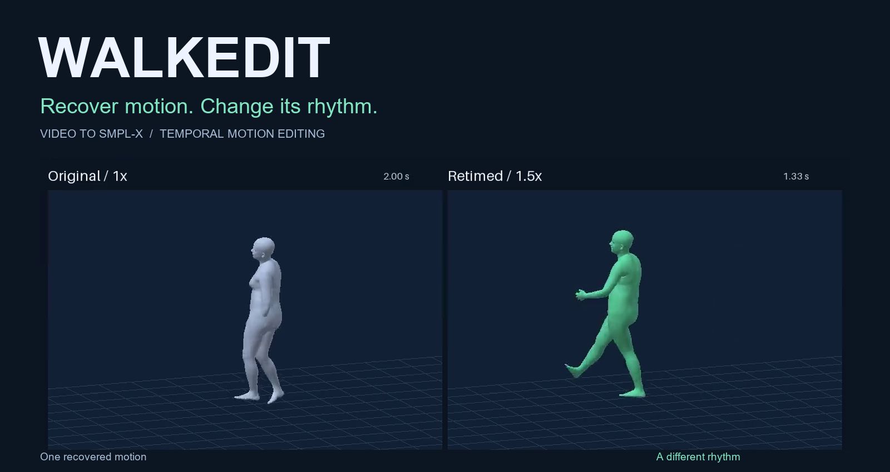
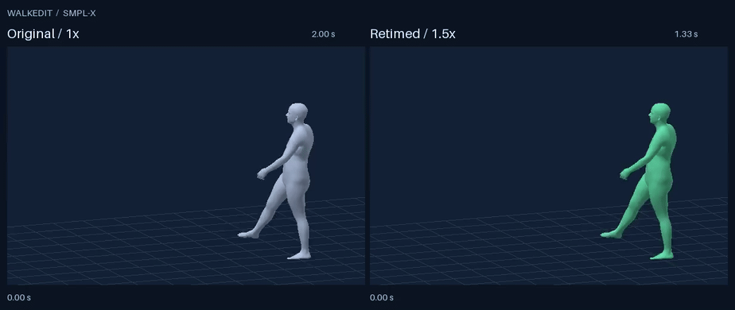
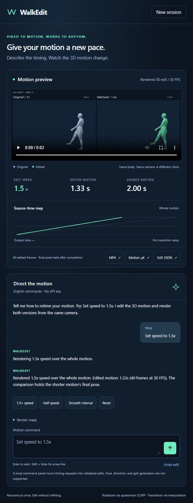

<div align="center">



# WalkEdit

**Recover human motion from video. Edit its timing in 3D.**

A computer vision baseline for monocular SMPL-X fitting, temporal motion editing, and reproducible visual comparison.


[Chat workspace](#chat-workspace) · [Quick start](#quick-start) · [Video fitting](#fit-your-own-video) · [Method](docs/METHOD.md)

</div>

## See the motion



A **2.00-second** walking clip from KTH is reconstructed as SMPL-X motion and retimed at **1.5× speed**. Both versions render at 30 FPS from the same camera. The edited motion lasts **1.33 seconds**, then holds its final pose while the original finishes.

[Watch the MP4](docs/assets/smplx-comparison.mp4) · [Local interval edit](docs/assets/segment-comparison.mp4)

## Why this project

| Stage | Implementation | Output |
| --- | --- | --- |
| Recover | Video landmarks, confidence-weighted SMPL-X joint fitting, temporal regularization | Pose, orientation, shared body shape, estimated root translation |
| Edit | Source-time mapping, linear translation interpolation, quaternion SLERP | A motion with a new duration or locally edited interval |
| Compare | Mesh generation and shared-camera OpenGL rendering | Side-by-side video and fitting diagnostics |

Reconstruction, editing, and rendering run independently through a documented motion format. Swap the reconstruction source or add a time map while reusing the downstream stages. See the [method](docs/METHOD.md) and [experiment plan](docs/RESEARCH.md).

## Chat workspace

**Type a timing command. Get a new 3D motion and a rendered comparison.** The English chat is a local, deterministic command interface; it does not require an API key or send prompts to an LLM.



[Watch an actual 1.5x chat render](docs/assets/chat-demo.mp4)

After [fitting a video](#fit-your-own-video) and obtaining the SMPL-X body model:

```bash
python -m pip install -r requirements-app.txt
python walkedit_app.py --motion outputs/original.pt --body-model data/SMPLX_NEUTRAL.npz
```

Open **http://127.0.0.1:7863**. The local demo defaults to `outputs/walk-original.pt` if `--motion` is omitted. The source motion and body model are not bundled; they must already exist. The chat edits an existing reconstruction rather than uploading or fitting a new video.

| Say | Result |
| --- | --- |
| `Set speed to 1.5x` | Absolute 1.5x timing relative to the original motion |
| `Make it 20% slower` | Multiply the current target speed by 0.8 |
| `Set speed to 2x from 0.5 to 1.5 seconds` | Edit that interval of source time |
| `Set speed to 2x from 0.5 to 1.5 seconds with a smooth transition of 0.2 seconds` | Ramp into and out of the interval |
| `Set the whole motion to 0.5x` | Clear the interval and slow the whole motion |
| `Undo` / `Reset` | Restore the previous successful edit / original timing |

Commands preserve the current interval and ramp unless explicitly changed. `Reset` clears both. An x-speed always refers to the original motion, not a chain of resampled files. Percentages change the current requested speed. These semantics are shown in the chat before rendering. Unclear, unsupported, out-of-range, and compound requests ask for clarification without changing the motion.

The workspace accepts trusted local reconstructions up to 30 seconds and speeds from **0.25x to 4x**. Each successful edit writes an immutable MP4, edited `.pt`, and JSON plan with the full output-to-source time map. Undo reuses completed renders where possible. Failed renders preserve the previous successful edit. The shorter motion holds its final pose in the comparison; its encoded duration is reported separately.

OpenGL 3.3 and the fitting dependencies are required for mesh rendering. Processing runs locally in one worker; the server binds to loopback. Session history and renders persist under `outputs/chat/` and are excluded from Git. This is a local research workspace, not an authenticated multi-user service. See [chat behavior and validation](docs/CHAT.md).

## Quick start

Use **Python 3.10+**. The skeleton example runs on CPU with the small dependency set.

```bash
python -m venv .venv
# Linux / macOS
source .venv/bin/activate
# Windows PowerShell
# .venv\Scripts\Activate.ps1

python -m pip install -r requirements.txt
python scripts/demo.py
```

The demo downloads ACCAD **Figure Quick Walk**, crops seconds 2–8, and writes **outputs/demo.mp4**.

```bash
# Edit only seconds 2–4 of the cropped motion.
python scripts/demo.py --speed 1.5 --start 2 --end 4

# Ramp smoothly into and out of the edit.
python scripts/demo.py --speed 1.5 --start 2 --end 4 --transition 0.4

# Reuse the downloaded sample.
python scripts/demo.py --offline
```

The skeleton example uses ACCAD motion capture. The mesh example above is reconstructed from a KTH video. See [data sources and terms](THIRD_PARTY.md).

## Fit your own video

Use a short clip with one fully visible person, a fixed camera, and visible feet.

```bash
python -m pip install -r requirements-fit.txt
```

Download [Pose Landmarker Heavy](https://storage.googleapis.com/mediapipe-models/pose_landmarker/pose_landmarker_heavy/float16/1/pose_landmarker_heavy.task) into **data/pose_landmarker_heavy.task**. Obtain **SMPLX_NEUTRAL.npz** through the [SMPL-X download page](https://smpl-x.is.tue.mpg.de/download.php) and put it in **data/**.

```bash
python fit_smplx.py walk.mp4 data/pose_landmarker_heavy.task data/SMPLX_NEUTRAL.npz outputs/original.pt
python retime.py outputs/original.pt outputs/faster.pt --speed 1.5
python render_smplx.py outputs/original.pt outputs/faster.pt data/SMPLX_NEUTRAL.npz outputs/comparison.mp4
```

The fitter writes **outputs/original.metrics.json** with landmark confidence, pixel reprojection RMSE, and pseudo-3D fitting RMSE. These measure agreement with estimated landmarks. A ground-truth 3D benchmark is required to measure reconstruction accuracy. The included KTH example detected 60/60 frames and achieved 3.15-pixel weighted reprojection RMSE in the upscaled 640 × 480 image. [Recorded diagnostics](docs/example-metrics.json).

Rendering requires **OpenGL 3.3**. The full baseline was exercised on Windows with Python 3.12, CPU PyTorch, and software OpenGL. Headless Linux needs an available OpenGL context, for example through Xvfb and Mesa.

## Edit an existing reconstruction

```bash
python retime.py original.pt edited.pt --speed 1.5 --start 0.5 --end 1.5
```

Add **--transition 0.25** for a smooth speed ramp at each interval edge. Smooth ramps reach the requested peak speed and have a longer duration than a hard switch.

Interval boundaries use **source seconds**. The output clock maps through the edited interval and continues along the remaining source motion. Rotation interpolation follows the shortest quaternion path.

The motion format uses **smpl_params_global** with **global_orient**, **body_pose**, **transl**, and **betas**. A missing frame rate defaults to 30 FPS. This matches the body-motion fields of GVHMR demo results. External GVHMR results need their own validation. Rendering uses default hands, face, and expression. See [method and format notes](docs/METHOD.md).

## What works today

- CPU video-to-SMPL-X body fitting with a shared body shape.
- Whole-clip and interval-specific speed changes, with optional smooth transitions.
- Quaternion SLERP and linear root translation resampling.
- Shared-camera mesh and BVH comparison videos.
- Fitting diagnostics and timing regression checks.
- English timing commands, source-interval edits, undo, and downloadable 3D chat results.

Current limitations include monocular depth ambiguity, errors during limb occlusion, a weak-perspective camera approximation, and possible foot sliding or floor penetration. Root depth translation is fixed. Hard edits switch speed abruptly at their boundaries; smooth transitions are available through --transition. Hands, face, free-form conversational reasoning, and new gait generation are not implemented. The chat supports the documented timing commands.

## Explore the code

```text
fit_smplx.py          Video landmarks → SMPL-X parameters + diagnostics
retime.py             Source-time mapping and motion resampling
render_smplx.py       Shared-camera mesh comparison
preview_walk.py       BVH forward kinematics and skeleton preview
scripts/demo.py       Downloadable CPU example
chat_commands.py      English timing command -> validated edit plan
walkedit_app.py       Local chat API, sessions, and rendering jobs
chat_render.py        Trusted SMPL-X retiming and rendering worker
web/                  Chat workspace interface
tests/               Timing and interpolation checks
docs/                Method, research plan, and demo media
```

```bash
python -m unittest discover -s tests -v
```

Read the [contribution guide](CONTRIBUTING.md). Reconstruction changes should report fitting residuals and visual failure cases. Temporal editing changes should report achieved duration and inspect interval boundaries.

## Acknowledgments and terms

Built with [SMPL-X](https://smpl-x.is.tue.mpg.de/), [MediaPipe](https://developers.google.com/edge/mediapipe/solutions/vision/pose_landmarker), [PyTorch](https://pytorch.org/), [SciPy](https://scipy.org/), and [ModernGL](https://moderngl.readthedocs.io/). Demonstrations use [KTH Actions](https://www.csc.kth.se/cvap/actions/) and [ACCAD / The Ohio State University](https://accad.osu.edu/research/motion-lab/mocap-system-and-data).

Original project code is released under the [MIT license](LICENSE). Body models, datasets, pretrained weights, and demonstration media retain their applicable terms. See [THIRD_PARTY.md](THIRD_PARTY.md).
